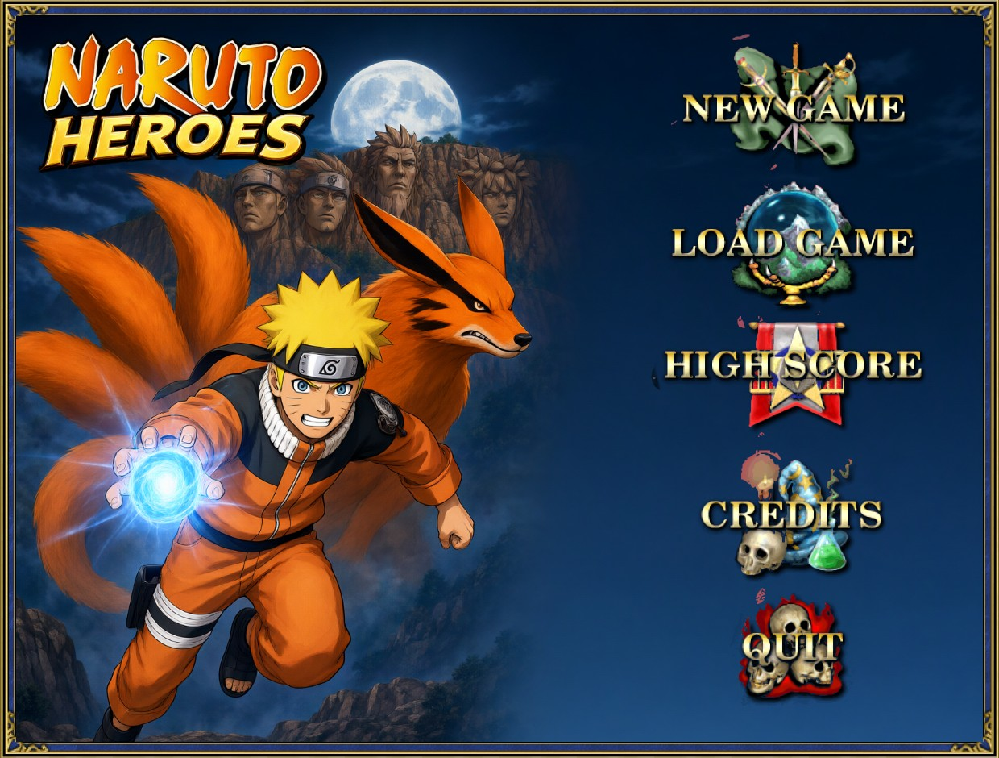
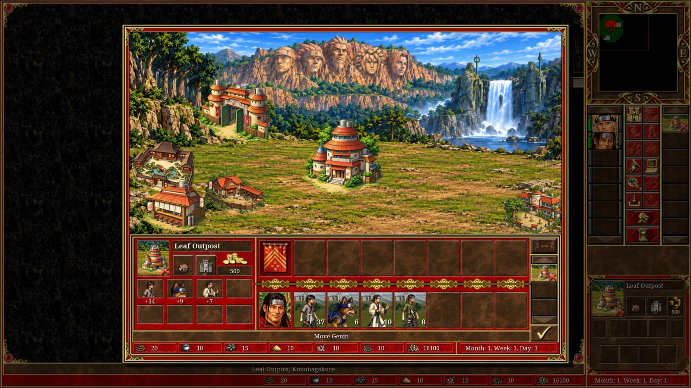
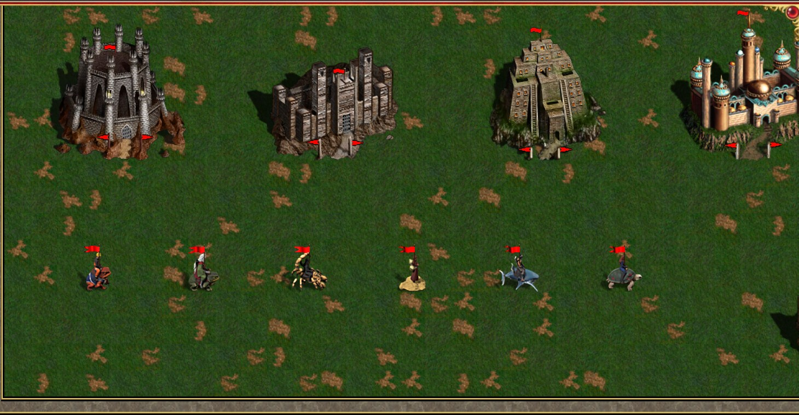
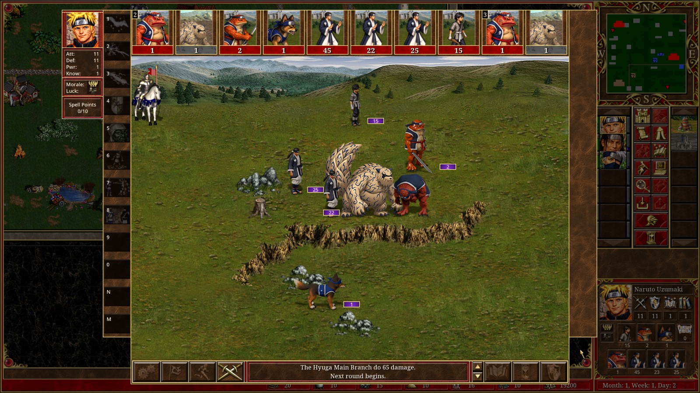
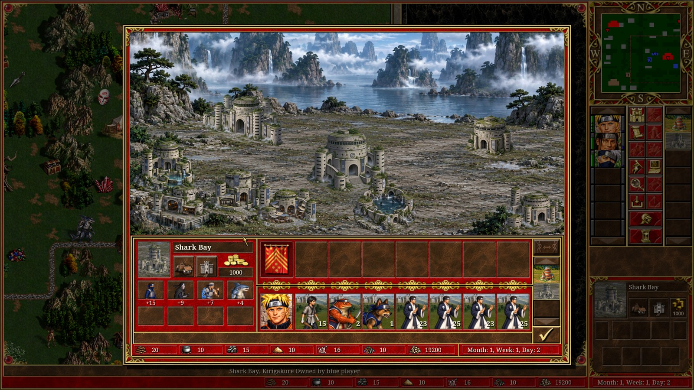

# Naruto Heroes

A mod for [VCMI](https://vcmi.eu) 1.7 (the open-source engine for Heroes of Might and Magic III)
that brings three hidden villages from *Naruto* into the game as playable towns. English and
Russian.

## What's inside

- **Three towns:** Konohagakure, Sunagakure and Kirigakure. Each has 14 animated creatures,
  2 hero classes, its own heroes (Naruto, Sasuke, Kakashi, Gaara, Temari, Zabuza, Mei and 44
  more), town screens and adventure-map buildings.
- **Heroes ride Naruto mounts on the map:** Naruto on a toad, Jiraiya on a toad, Kankuro on
  a scorpion, Gaara on a sand cloud, Zabuza on a shark, Mei on a sea turtle.
- **Neutral ninja:** 11 neutral creatures with their own map lairs.
- **Tailed-beast bosses:** Shukaku, Isobu, Gyuki and Kurama.
- **43 artifacts,** including the Hokage, Kazekage and Mizukage sets.
- **A Naruto main menu,** loading screen and scenario backgrounds.
- **Three maps** (in the scenario list once the mod is on):
  - **Naruto: The Uzumaki Spiral.** A co-op story for two players against the AI. Naruto
    and Gaara land on opposite shores of the island ruins of Uzushiogakure; each one's road
    is sealed by keys lying on the other's. About 2–3 hours.
  - **Naruto: Akatsuki's Shadow.** A solo story: free Kakashi and defeat Shukaku within
    eight weeks.
  - **Naruto vs Sasuke.** A duel for two players at the Valley of the End.

| | |
|---|---|
|  |  |
|  |  |

## Install

1. Download this repository as a zip (`Code → Download ZIP`).
2. In the VCMI launcher, use **Import files** on the zip. Or unpack it into VCMI's `Mods`
   folder as `naruto-heroes`.
3. Enable **Naruto Heroes** in the launcher.

You need the original Heroes III data that VCMI uses. The mod borrows some original graphics
and sounds from it; the few pictures it ships that are made from original art are the menu
buttons, with the old background's glow removed, and creature portraits on the original
portrait backgrounds. For network play both computers need the same mod version.

Playing in Russian: switch the game language to Russian and enable VCMI's `russian-translation`
mod for the engine's own texts. The mod's texts, maps and menu buttons follow the language by
themselves (the Russian buttons are the sub-mod "Russian menu buttons"). After a start in another
language VCMI switches Russian translation mods off: enable them again in the launcher.

## How it was made

The mod was built with an LLM coding agent (Claude Code) and a self-hosted image and 3D
pipeline. It's a project of [homm3-mod-creator](https://github.com/reconcrete/homm3-mod-creator),
where the tools, generators and play-test setup live. The art is AI-generated and was checked
by eye in the real game.

## Licence and disclaimer

A fan-made, non-commercial project. *Naruto* and its characters belong to Masashi Kishimoto,
Shueisha and Studio Pierrot. *Heroes of Might and Magic* belongs to Ubisoft. This mod is not
affiliated with or endorsed by them. The mod's own pictures and configuration are released
under [CC BY-NC 4.0](https://creativecommons.org/licenses/by-nc/4.0/).
